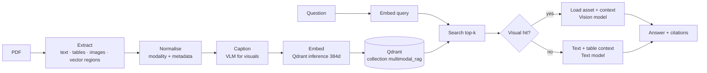
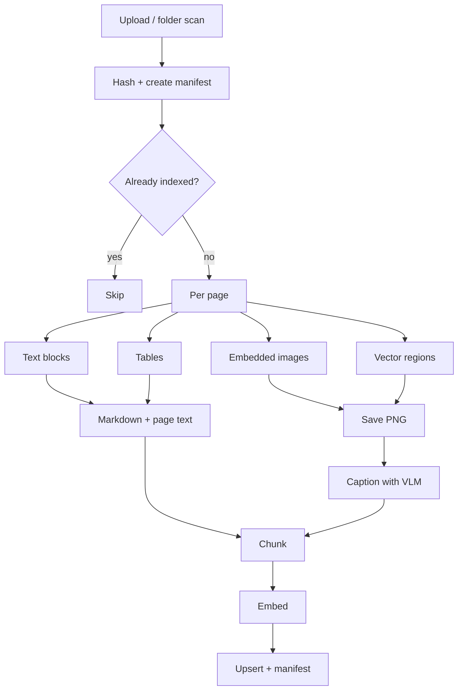

# Multimodal RAG — Architecture

**Status:** design approved, implementation not started.
**Scope:** local, single-user, two sample PDFs, free-tier services.
**Companion:** the learning notes in `Docs/` explain the concepts; this document is the build contract.

---

## 1. Goal

Turn a PDF into searchable text **and** searchable visuals, answer a question with grounded citations, and show the evidence the answer came from.

Success means: a question whose answer lives only in a chart gets answered **and** shows that chart.

---

## 2. Locked decisions

| Area | Decision | Why | Rejected |
|---|---|---|---|
| Vector DB | **Qdrant Cloud**, existing cluster, collection `multimodal_rag` | one free cluster already exists | a second cluster (not allowed on free tier) |
| VLM | **OpenRouter**, free vision model, config-driven with fallback | one key, no local GPU | local VLM |
| Embeddings | **Qdrant Cloud Inference**, `sentence-transformers/all-MiniLM-L6-v2`, 384-d | server-side, no local model and no extra key (HF inference credits returned 402) | HF Inference API, local CLIP |
| Image representation | **VLM caption → text embedding** (option A) | one vector space, strong on charts | CLIP/SigLIP image vectors |
| Python | existing repo `venv/` | already provisioned | uv, poetry, new venv |
| UI | **FastAPI + plain HTML/CSS/JS** | full control, no build step | Streamlit |
| Chunking | page-level text; tables and visuals never split | citations stay exact | fixed 512-token windows |
| PDF visuals | embedded images first; **vector regions via `get_drawings()` → clip render** | 2 of the sample figures are vector-only | image-only extraction |
| Assets | local `assets/`, behind a storage adapter | no S3 yet; swap later without touching the pipeline | direct file writes |
| Text fallback | **Groq** `openai/gpt-oss-120b` | OpenRouter's free pool rate-limits under load; Groq keeps text answers alive | retry loops only |

---

## 3. System overview



Two pipelines, one collection. Ingestion writes; querying reads. Nothing is shared except the index and the embedding model.

---

## 4. Directory layout

```
multimodal-RAG/
├── apps/
│   ├── config.py          env loading, constants, validation
│   ├── models.py          Document, Chunk, Hit, Answer dataclasses
│   ├── pdf_extract.py     PyMuPDF: text, tables, images, vector regions
│   ├── assets.py          storage adapter (local now, S3 later)
│   ├── caption.py         OpenRouter VLM calls + retries
│   ├── vectorstore.py     Qdrant: ensure collection, upsert, search, delete
│   ├── ingest.py          orchestration + manifest + status
│   ├── rag.py             retrieve → select → route → answer
│   ├── api.py             FastAPI routes + static files
│   └── cli.py             ingest / query / stats
├── web/
│   ├── index.html         single page, three tabs
│   ├── app.js             fetch calls, rendering, polling
│   └── styles.css
├── assets/                extracted visuals, per document (gitignored)
├── data/
│   ├── pdfs/              corpus
│   └── manifests/         one JSON per document: status + counts
├── Docs/                  learning notes + Excalidraw diagrams
├── ARCHITECTURE.md        this file
└── .env                   secrets (gitignored)
```

`apps/` is the only Python package. No notebook is part of the runtime.

---

## 5. Data model

### 5.1 Document

| Field | Type | Notes |
|---|---|---|
| `document_id` | string | `doc_` + first 12 chars of the file hash |
| `source` | string | original filename |
| `doc_hash` | string | sha256 of the file bytes; used for dedupe |
| `pages` | int | page count |
| `status` | enum | `uploaded → extracting → captioning → embedding → indexed`, or `partial`, `failed` |
| `created_at` | ISO string | |
| `counts` | object | `{text, table, visual}` after indexing |
| `error` | string? | last failure, shown in the UI |

Status lives in `data/manifests/{document_id}.json`, not in Qdrant. Qdrant stores vectors, not job state.

### 5.2 Chunk — one Qdrant point

| Field | Type | Text | Table | Visual |
|---|---|---|---|---|
| `document_id` | string | ✓ | ✓ | ✓ |
| `chunk_id` | string | `p3_t1` | `p4_tb1` | `p7_fig1` |
| `modality` | enum | `text` | `table` | `visual` |
| `content` | string | page text | markdown table | VLM caption |
| `source` | string | ✓ | ✓ | ✓ |
| `page` | int (1-based) | ✓ | ✓ | ✓ |
| `bbox` | [x0,y0,x1,y1] | optional | table bbox | asset bbox |
| `asset_path` | string | — | — | `assets/doc_x/p7_fig1.png` |
| `asset_hash` | string | — | — | sha256 of the PNG |
| `table_number` | int | — | ✓ | — |
| `part` | int | only if a page is split | — | — |
| `caption_model` | string | — | — | model id used |
| `caption_status` | enum | — | — | `ok` / `failed` |
| `text_hash` | string | ✓ | ✓ | sha256 of `content` |
| `created_at` | ISO | ✓ | ✓ | ✓ |

**Point ID:** UUIDv5 of `document_id + ":" + chunk_id`. Deterministic — re-ingesting overwrites the same point instead of duplicating it.

### 5.3 Modality rules

| Value | Contains |
|---|---|
| `text` | prose only; text inside a table or figure bbox is excluded |
| `table` | one table, as markdown, header row preserved |
| `visual` | one image or one vector region; `content` is always the caption |

---

## 6. Ingestion



| # | Step | Output | Failure behaviour |
|---|---|---|---|
| 1 | Register | manifest with `uploaded` | invalid file → `failed`, no partial data |
| 2 | Extract | per-page text, tables, image regions, vector regions | page-level try/except; a bad page is logged and skipped |
| 3 | Save assets | PNGs under `assets/{document_id}/` | disk error → document `failed` |
| 4 | Caption | 60–120 word factual caption per visual | 3 retries, then `caption_status=failed`, document `partial` |
| 5 | Chunk | text / table / visual chunks | empty page → no chunk, logged |
| 6 | Embed | 384-d vector per chunk | retry with backoff; failed batch → `partial` |
| 7 | Upsert | points in `multimodal_rag` | Qdrant error → `failed`, assets kept for retry |

**Concurrency:** one ingestion at a time (a simple lock). The UI shows progress by polling the manifest.

### 6.1 Text

- `page.get_text("blocks")` rather than raw text, so bboxes are available.
- Drop blocks whose bbox intersects a table bbox or a figure bbox — that text is already represented by the table/visual, and duplicating it makes the visual look irrelevant in search.
- Normalise whitespace; drop blocks under 20 characters that contain no letters.
- If the page yields no text, flag `ocr_required` on the manifest. OCR is out of scope for v1.

### 6.2 Tables

- `page.find_tables()`; each table extracted as rows, rendered as markdown.
- Header row preserved; empty cells become `—` so the column count stays stable.
- One chunk per table. Never split.
- Text inside the table bbox is excluded from the text chunk.

### 6.3 Embedded images

- `page.get_image_info()` gives each image's bbox in page coordinates.
- **Render the bbox with `page.get_pixmap(clip=bbox, dpi=200)`** instead of extracting the raw xref. Reason: consistent colour handling, no separate alpha mask, and the crop matches exactly what a reader sees.
- Skip images smaller than 80×80 pt (logos, bullets, icons).
- Cap the long edge at 2,000 px.

### 6.4 Vector regions

This is the part most pipelines skip. `get_drawings()` returns every path with a rect; a chart is a few hundred of them.

Algorithm, per page:

1. Collect drawings; drop full-page borders, rules thinner than 2 pt, and rects under 40×40 pt.
2. Drop drawings whose bbox sits inside a detected table bbox.
3. Expand each remaining rect by 8 pt; union overlapping/near rects until stable (union-find).
4. Keep clusters that are at least 60×60 pt **and** cover at least 2% of the page area.
5. Bbox = union of the cluster; expand by 12 pt; clamp to the page.
6. **Merge text blocks whose centre falls inside the bbox** — axis labels, legends and titles are text objects, not paths. Without this step the crop cuts the numbers off.
7. If the bbox covers more than 70% of the page, render the whole page instead (the drawing is a background, not a figure).
8. Render at 200 dpi, hash the PNG, skip if the hash already exists on that page.

Tunable constants live in `config.py`; the thresholds are the ones we will adjust against the two sample PDFs.

**Expected effect on the corpus:**

| PDF | Embedded images | Vector regions | Total visuals |
|---|---|---|---|
| NovaCore | 8 | 0 | 8 |
| Siddiqui children | 8 | 2 (p3 Ayaan chart, p8 relationship map) | 10 |

### 6.5 Captioning

Prompt (fixed, versioned in `caption.py`):

> Describe this figure factually in 60–120 words. Include every number, axis label, unit and trend direction. Do not interpret or speculate. If it is a diagram, state what connects to what.

Rules:

- One call per visual, 3 retries with exponential backoff, cached by image hash under `data/captions/`.
- Images are downscaled to a 1,600 px long edge and sent as base64 data URLs.
- The caption is the retrievable text; the PNG is the answer-time evidence.
- `caption_status=failed` still stores the point, with `content = "Figure on page N (caption unavailable)"`, so the page is visible but not semantically searchable.

### 6.6 Chunking and embedding

- Text: one chunk per page. **If a page exceeds 1,500 characters**, split at paragraph boundaries into parts of ≤1,500 chars, all carrying the same page and `part` number. Reason: `bge-small` truncates at 512 tokens; a 4,000-character page would otherwise lose its second half silently.
- Table: one chunk.
- Visual: one chunk.
- Embed `content` via Qdrant Cloud Inference (the vector is `{text, model}` sent to Qdrant, not computed locally).
- Modality is never embedded — it is payload.

---

## 7. Retrieval and generation

| Step | Detail |
|---|---|
| 1 | Embed the question with the same model as ingestion |
| 2 | Qdrant search, `k = 8` by default (UI slider 4–12), optional modality filter |
| 3 | Keep the top 6 by score; always keep at least one visual if a visual is in the top 8 |
| 4 | Build context blocks labelled `[p3 · visual]`, `[p4 · table]` |
| 5 | Route: any selected visual → vision model; otherwise text model |
| 6 | Return answer + sources + route |

**Why force a visual in:** charts often score just below prose because captions are short. If the question is about a trend or a figure, dropping the only visual is the difference between an answer and a guess. The rule is one line and reversible.

### 7.1 Context assembly

```
[p3 · table]
| Metric | FY2025 | FY2026 |
...

[p7 · visual]
Resolution time falls from 14.2 h to 8.1 h between January and August.
```

Each block is capped at 1,200 characters; total context at 6 blocks.

### 7.2 Answer contract

```json
{
  "answer": "Resolution time fell from 14.2 h in January to 8.1 h in August — about 43% faster.",
  "route": "vision",
  "sources": [
    {"page": 7, "modality": "visual", "asset_path": "assets/doc_x/p7_fig1.png", "score": 0.82},
    {"page": 2, "modality": "text", "score": 0.76}
  ],
  "usage": {"prompt_tokens": 0, "completion_tokens": 0}
}
```

### 7.3 Prompts

**Text path**

> Answer only from the context. If the answer is missing, say "not in the document". Cite the page for every number, as [p4].

**Vision path**

> Answer only from the context and the attached images. Read values directly from the image; do not estimate or interpolate. Cite page and image. If a value is not visible, say so.

### 7.4 Streaming

The answer streams token by token. Retrieval is **not** streamed — it finishes first, so the sources are known before the model starts writing.

**Transport:** `POST /api/query` with `"stream": true` → `text/event-stream`. Plain `fetch` + `ReadableStream` in the UI (not `EventSource`, which cannot POST).

**Event protocol:**

| Event | Payload | When |
|---|---|---|
| `meta` | `{route, sources[], k}` | immediately after retrieval, before generation |
| `token` | `{text}` | per delta |
| `done` | `{usage, finish_reason}` | end of generation |
| `error` | `{message, retryable}` | mid-stream failure |

```
event: meta
data: {"route":"vision","sources":[{"page":7,"modality":"visual","score":0.82}]}

event: token
data: {"text":"Resolution time fell "}

event: done
data: {"usage":{"prompt_tokens":1840,"completion_tokens":96}}
```

Rules:

- The UI renders the source chips on `meta`, so citations appear before the answer finishes.
- A 15-second heartbeat comment (`: ping`) keeps proxies from closing an idle stream.
- OpenRouter is called with `stream: true` on both routes; the vision path streams the same way.
- Mid-stream failure keeps the partial text, marks it "incomplete", and offers retry.
- The Abort button cancels the fetch; the server stops reading upstream and releases the stream.
- `stream: false` returns the JSON contract in §7.2 unchanged — CLI and tests use that path.

---

## 8. Qdrant

### 8.1 Collection

| Setting | Value |
|---|---|
| Name | `multimodal_rag` |
| Vector size | 384 |
| Distance | cosine |
| On create | create if missing; if present with a different size, **stop and report** — never drop |
| Points | one per chunk |

### 8.2 Payload indexes

Create on first ingest (idempotent):

| Field | Schema |
|---|---|
| `modality` | keyword |
| `document_id` | keyword |
| `page` | integer |
| `source` | keyword |

### 8.3 Filters used

| Goal | Filter |
|---|---|
| charts only | `modality = visual` |
| one document | `document_id = doc_x` |
| one page (debug) | `page = 7` |
| text + tables | `modality in [text, table]` |

### 8.4 Operating rules

- The two existing collections (`denial_narratives`, `rule_embeddings`) are never read, written or dropped.
- Collection name is required config — no default. A typo must fail loudly.
- Re-ingest deletes points for that `document_id` first, then upserts; assets are reused by hash.
- Deleting a document = delete points by filter + delete its asset folder.

---

## 9. API

| Method | Path | Purpose |
|---|---|---|
| GET | `/api/health` | Qdrant reachability + OpenRouter key |
| POST | `/api/documents` | multipart upload → `{document_id, status}` |
| POST | `/api/documents/{id}/ingest` | start ingestion (`?force=true` to redo) |
| GET | `/api/documents` | list with status and counts |
| GET | `/api/documents/{id}` | manifest + chunk list summary |
| DELETE | `/api/documents/{id}` | delete points + assets |
| POST | `/api/query` | `{question, k?, modalities?, stream?}` → answer JSON, or SSE when `stream=true` |
| GET | `/assets/{path}` | serve extracted images |
| GET | `/` | the UI |

`POST /api/ingest` for folder scanning is CLI-only (`python -m apps.cli ingest data/pdfs`), not HTTP — deliberately, so the web surface cannot read arbitrary paths.

Query example:

```json
{"question": "What share of Penang electricity came from solar?", "k": 6, "modalities": ["visual", "table", "text"]}
```

Errors are JSON `{error, detail}` with 4xx for bad input, 503 when a dependency is down.

---

## 10. UI

One page, three tabs, no framework.

**Ingest**

- Dropzone + file picker; uploads one PDF at a time.
- Document list: name, pages, status pill, counts (`3 text · 2 tables · 1 visual`), error text.
- Per-document actions: Ingest / Re-ingest / Delete.
- During ingestion: progress text from the manifest (`captioning 4/10`), polled every 1.5 s.

**Search**

- Query box; `k` slider; modality chips (all / text / table / visual).
- Answer panel: route badge (`vision` / `text`), the answer **streamed token by token**, source chips (`p7 · visual`).
- Source chips render on `meta`, before the first token.
- While streaming: blinking caret and a Stop button; after `done`: copy button.
- Evidence list: each hit as a card — modality chip, page, score, snippet; visual hits show a thumbnail that opens full size.
- Empty state: "No hits — ingest a PDF first."

**Documents**

- Table of documents with counts and a link to filter search by that document.
- Clicking a visual in search opens the asset at full resolution.

Visual language follows the Docs: navy `#1F3864`, teal `#2F7D6D`, modality colours blue/green/orange, light grey surfaces.

---

## 11. Configuration

| Variable | Required | Default | Notes |
|---|---|---|---|
| `QDRANT_URL` | yes | — | cluster endpoint, `:6333` |
| `QDRANT_API_KEY` | yes | — | |
| `QDRANT_COLLECTION` | yes | — | must be `multimodal_rag` for this project |
| `OPENROUTER_API_KEY` | yes | — | |
| `OPENROUTER_VISION_MODEL` | no | first working free VLM | fallback list in config |
| `OPENROUTER_TEXT_MODEL` | no | free text model | can equal the vision model |
| `GROQ_API_KEY` | no | read from the repo-root `.env` | text-only fallback provider |
| `EMBED_MODEL` | no | `sentence-transformers/all-MiniLM-L6-v2` | must match the collection |
| `EMBED_DIM` | no | 384 | validated against the collection |
| `EMBED_DIM` | no | 384 | validated against the collection |
| `PAGE_RENDER_DPI` | no | 200 | vector/image crops |
| `VLM_IMAGE_MAX_PX` | no | 1600 | long edge before sending |
| `TOP_K` | no | 6 | |
| `ASSET_DIR` | no | `assets` | |

Startup validation: fail fast with a readable message if a required value is missing or the collection size mismatches.

---

## 12. Failure modes

| Failure | Symptom | Handling |
|---|---|---|
| Qdrant unreachable | search 503 | health banner; retry button |
| Qdrant inference error | embedding fails | retry, resume from manifest |
| OpenRouter rate limit | captions fail | retry, then `caption_status=failed`, doc `partial`; text answers fall back to Groq |
| Scanned PDF | no text chunks | flag `ocr_required`; visuals still ingested |
| Vector clustering merges two figures | one crop with both | acceptable v1; bbox logged for tuning |
| Wrong visual forced into context | irrelevant image | threshold: only force if score ≥ 0.35 |
| Duplicate upload | double points | `doc_hash` skip, deterministic point IDs |
| Collection size mismatch | 384 vs 1536 | refuse to start; never auto-recreate |

---

## 13. Limits and cost

| Item | Per document | Per question |
|---|---|---|
| VLM captions | 1 call per visual | 1 call if vision route |
| Embeddings | 1 per chunk | 1 |
| Qdrant | 1 upsert batch | 1 search |
| Expected chunks | NovaCore ~24, Siddiqui ~31 | — |

Free-tier assumptions: Qdrant single cluster (already used) with Cloud Inference token usage, OpenRouter free-model rate limits. For two PDFs this is comfortably inside the limits; a 200-page corpus would need a paid tier.

---

## 14. Acceptance tests

| # | Test | Expected |
|---|---|---|
| 1 | Ingest NovaCore | status `indexed`; ≥8 visuals, ≥6 tables, 9 pages of text |
| 2 | "What was FY2026 revenue?" | $132.0M, cites p3 |
| 3 | "What % of Penang electricity was solar?" | 34%, route `vision`, cites p8 |
| 4 | "Where is the critical quality-control point?" | Quality Lab, Singapore, cites p6 |
| 5 | Ingest Siddiqui children | `indexed`; 10 visuals (8 raster + 2 vector) |
| 6 | "Which vaccination is due in November 2026?" | HPV dose 1, cites p7 |
| 7 | "What was Ayaan's height at age 6?" | ~116 cm, cites p3 — proves the vector fallback |
| 8 | "Which clinician treats both children?" | Dr. Hina Qureshi, cites p8 — vector map |
| 9 | Filter `modality=visual` for "solar" | returns the pie chart only |
| 10 | Delete a document | points gone, assets gone, search no longer returns it |
| 11 | Query with `stream=true` | `meta` arrives before the first token; sources visible immediately; Stop cancels the stream |

Tests 7 and 8 are the ones that fail if the vector fallback is not implemented.

---

## 15. Build order

| Milestone | Deliverable | Commit boundary |
|---|---|---|
| M1 | `pdf_extract` — text, tables, images to JSON + assets | one commit, CLI dump |
| M2 | vector-region detection + clip render | one commit, verified on p3/p8 |
| M3 | embeddings + Qdrant upsert + manifests | one commit, CLI ingest |
| M4 | retrieval + answer contract (text only) | one commit, CLI query |
| M5 | captioning + vision route | one commit, acceptance test 3 |
| M6 | FastAPI + SSE streaming + UI | one commit per tab if needed |
| M7 | acceptance run on both PDFs + Docs update | one commit |

Each milestone is runnable before the next starts. `Docs/` gets a short implementation note linking here.

---

## 16. Out of scope (v1)

OCR · S3 · auth/multi-user · reranking · chart-to-table transcription · multi-page table merging · background queue · document versioning.

Each is an isolated addition: the storage adapter covers S3, the retrieval step has a single place for a reranker.
