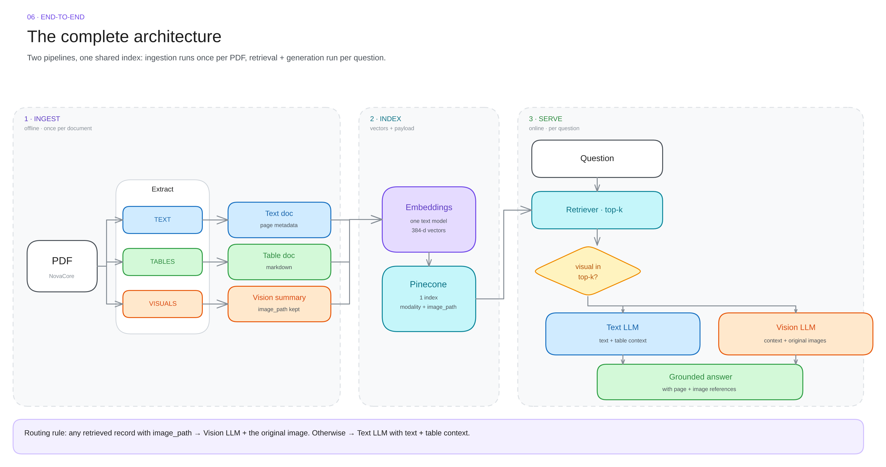

# 00 · Overview

The whole idea in ten lines, then the vocabulary you need for the rest of the notes.

---

## In ten lines

1. A real document is **not** one modality. Text, tables, images and charts share the page.
2. Classic RAG extracts text, chunks it, embeds it, retrieves it. Everything else is dropped.
3. Dropped evidence cannot be retrieved. If the answer lives in a chart, the model never sees it.
4. Fix: make **every** modality retrievable by converting it to text.
5. Text stays text. Tables become **markdown**. Images and charts become a **VLM-written factual summary**.
6. All of it is embedded by **one text embedding model** into **one vector space**.
7. The original image is **not** thrown away — its path is stored in metadata.
8. Retrieval returns summaries. If a hit is visual, the **original image is reloaded**.
9. A **vision LLM** answers with the pixels in front of it; otherwise a text LLM answers.
10. Result: one question can be answered from text, a table, a chart, or all three.

---

## The one-sentence definition

> Convert every useful modality into something retrievable, then give the final model the **original evidence** it needs to answer accurately.

Two halves, both required:

| Half | Wrong version | Right version |
|---|---|---|
| Retrieval | embed raw images with CLIP and hope | embed a **text description** so one text query can rank everything |
| Generation | answer from the summary | answer from the **original** table / chart / photo |

If you only do the first half, you get vague answers. If you only do the second, you never find the right page.

---

## Vocabulary

| Term | Meaning here |
|---|---|
| **Modality** | The kind of content: text, table, image, chart. |
| **Modality-aware chunk** | A chunk that knows what it is. A page of prose, one table, one chart. Not a 512-token window cut through all three. |
| **Vision summary** | A factual, text description of an image written by a VLM at ingestion time. This is what gets embedded. |
| **Grounding** | The answer is written from retrieved evidence, with page + image references, not from model memory. |
| **Metadata contract** | The fixed set of keys every chunk carries: `page`, `modality`, `source`, and for visuals `image_path`. |
| **Namespace** | A logical partition inside a vector index. We use **one**. |
| **top-k** | How many chunks retrieval returns. Default 4. |
| **Router** | The 3-line `if` that decides text LLM vs vision LLM. Not a graph framework. |

---

## The three stages

| Stage | Question it answers | Input | Output |
|---|---|---|---|
| **1 · Ingestion** | What is in this document? | PDF | Documents + vectors |
| **2 · Retrieval** | Which chunks are relevant? | question | top-k chunks (+ image paths) |
| **3 · Generation** | What is the answer, grounded? | question + chunks + images | answer + citations |

Ingestion is offline and expensive. Retrieval and generation are online and cheap. **Optimise them separately.**

---

## What "good" looks like

| Signal | Healthy | Unhealthy |
|---|---|---|
| Retrieval | the right page is in top-4 | the right page is at rank 30 |
| Route | visual hits actually reach the VLM | every answer is text-only |
| Answer | quotes numbers that exist in the source | rounds or invents numbers |
| Citation | page number + image path resolve | "according to the document" |

Next: [the problem →](01-the-problem.md)
