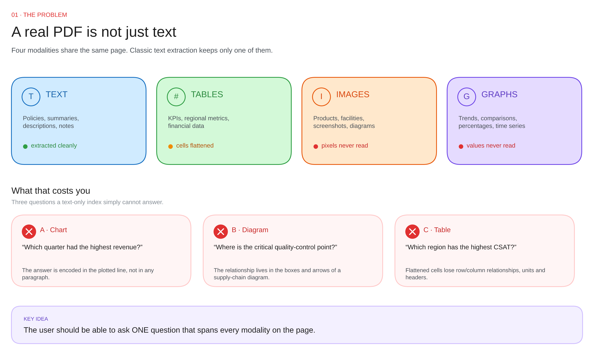

# 01 · The problem

---

## A real PDF is four documents stacked on one page

| Modality | What it holds | Text extraction gives you | What is lost |
|---|---|---|---|
| **Text** | policies, summaries, notes | the full text | nothing |
| **Table** | KPIs, regions, financials | a run of cell values | row/column meaning, units, headers |
| **Image** | products, facilities, screenshots | nothing (or an alt-text stub) | everything |
| **Chart** | trends, comparisons, time series | maybe axis labels | the data, the shape, the answer |

`page.get_text()` is not a bad tool. It is a **text** tool. Three of four modalities are not text.

---

## Why the classic pipeline fails

The classic pipeline, in order: PDF → extract text → chunk → embed → retrieve → answer.

This pipeline is correct for prose and silently wrong for everything else.

| Failure | Mechanism | Example |
|---|---|---|
| **Structure loss** | cells are concatenated left-to-right | "Which region has the highest CSAT?" — the header row is now a word salad |
| **Visual loss** | pixels are never read | "Which quarter had the highest revenue?" — the answer is a point on a line |
| **Relation loss** | arrows and layout carry meaning | "Where is the quality-control checkpoint?" — it lives in a diagram |
| **No cross-modal join** | text chunks and images are separate worlds | "Compare Q4 revenue (text) with the Q4 trend (chart)" |

The dangerous part is that **none of these throw an error**. Ingestion succeeds, retrieval succeeds, and the model answers confidently from the wrong evidence.

---

## The test for "do I need this?"

Ask: *can a user's question be answered only from the paragraph text?*

| Document | Multimodal RAG? |
|---|---|
| Contracts, policies, articles | ❌ plain text RAG is enough |
| Annual reports, research papers | ✅ tables + charts carry the numbers |
| Product catalogues, manuals | ✅ images carry identity |
| Dashboards exported to PDF | ✅ it is basically all charts |
| Scanned invoices | ⚠️ needs OCR first, then still multimodal |

Do not build this for a corpus that is 95% prose. The extra VLM calls and image storage buy you nothing.

---

## The design consequence

If the evidence is not text, **you must convert it to text at ingestion time** — but you must also keep the original, because a summary is lossy.

That single sentence produces the whole architecture:

| Pipeline | Does | Keeps |
|---|---|---|
| **Ingestion** | every modality → text, for search | the original, for answering |
| **Serving** | searches the text | answers from the original |

Next: [ingestion →](02-ingestion.md)
