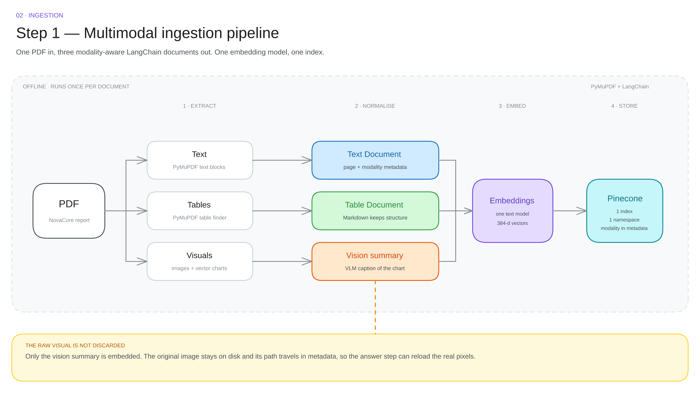

# 02 · Ingestion

Runs **once per document**. Expensive, offline, cacheable.

---

## The four steps

| # | Step | What it does | Output |
|---|---|---|---|
| 1 | **Extract** | pulls text blocks, tables and images out of the PDF | raw pieces |
| 2 | **Normalise** | turns each piece into a document with a modality and metadata | text / table / visual documents |
| 3 | **Embed** | one text embedding model, same for every document | 384-d vector each |
| 4 | **Store** | vector + metadata in Pinecone, one namespace | searchable index |

Everything after step 2 is identical for every modality. That is the point: **normalise early, so the rest of the system only ever sees text**.

---

## Step 1 — Extract

Three extractors, one page at a time.

| Target | How | What you get |
|---|---|---|
| **Text** | read the page's text layer | paragraphs, headings, notes |
| **Tables** | table detection on the page | cells + header row |
| **Images** | embedded image objects | photos, screenshots, raster charts |

| Gotcha | Fix |
|---|---|
| Scanned PDF → empty text layer | run OCR first |
| Chart is a **vector** drawing, not an embedded image | it will be missed — render the page region to an image instead |
| Multi-column layouts interleave | extract blocks, then sort by column |
| Borderless tables are not detected | fall back to a VLM reading a page crop |

> The vector-chart trap is the one that bites. Most financial charts in PDFs are drawn as vector paths, so an "extract embedded images" pass returns nothing and the charts silently disappear from the index.

---

## Step 2 — Normalise into three document types

### Text — one chunk per page

Keep the page as the unit. A page of prose is already a coherent chunk, and the page number is the citation.

### Table — markdown, not CSV

A table is converted to a markdown table: header row, then rows.

Markdown keeps the header attached to the cells, so the model still knows what a column means. Flattened CSV loses that, and the answer becomes a word salad.

### Visual — a VLM writes the summary

At ingestion time, each image is sent to a vision model with a strict instruction:

> Describe this figure factually. Include every number, axis label and trend. No interpretation.

The returned paragraph is the **only thing that gets embedded**. The image itself is never vectorised.

| Do | Don't |
|---|---|
| numbers, axis labels, units, trend direction | "a chart about revenue" |
| one paragraph, 40–120 words | a 600-word essay |
| "no interpretation" | opinions about why the trend happened |

A vague summary is a retrieval bug you will debug later at query time. Write it well once.

---

## The metadata contract

Every document carries these fields. Everything downstream depends on them.

| Field | Type | Present on | Used for |
|---|---|---|---|
| source | text | all | citation, filtering |
| page | number | all | citation, "page 7" |
| modality | text / table / visual | all | routing, filtering |
| image_path | text | visual only | reloading the original |
| table_number | number | table only | citation |

> If **modality** or **image_path** is missing, the vision route silently never fires. This is the most common bug in the whole build — and it produces no error message.

---

## Step 3–4 — Embed and store

| Choice | Default | Why |
|---|---|---|
| Embedding model | all-MiniLM-L6-v2, 384-d | free, local, good enough for English |
| Alternative | text-embedding-3-small, 1536-d | better recall, paid, one API call per chunk |
| Namespace | one | modality lives in metadata, not in the partition |
| Chunking | page for text, one chunk per table, one per visual | structure-aware beats fixed-size |
| Batch | 100 vectors per upsert | throughput without timeouts |

The same model must embed the documents **and** the questions. Mixing models produces random ranking.

---

## Cost model

| Item | Per document (≈20 pages, 6 figures) |
|---|---|
| PDF parsing | under a second |
| VLM summaries | 6 calls — **the dominant cost** |
| Embeddings | ~30 chunks, local, negligible |
| Upsert | one batch |

Ingestion cost is dominated by the VLM calls. Cache summaries by image hash: re-ingesting a document must not re-caption the same chart.

---

## Checklist

- [ ] every page returns non-empty text (or was OCR'd)
- [ ] every table becomes markdown with a header row
- [ ] every image **and vector chart** gets a summary
- [ ] image_path points at a file that still exists at query time
- [ ] modality is set on 100% of documents
- [ ] counts match: pages ≈ text docs, tables ≈ table docs, figures ≈ visual docs

Next: [vector store →](03-vector-store.md)
