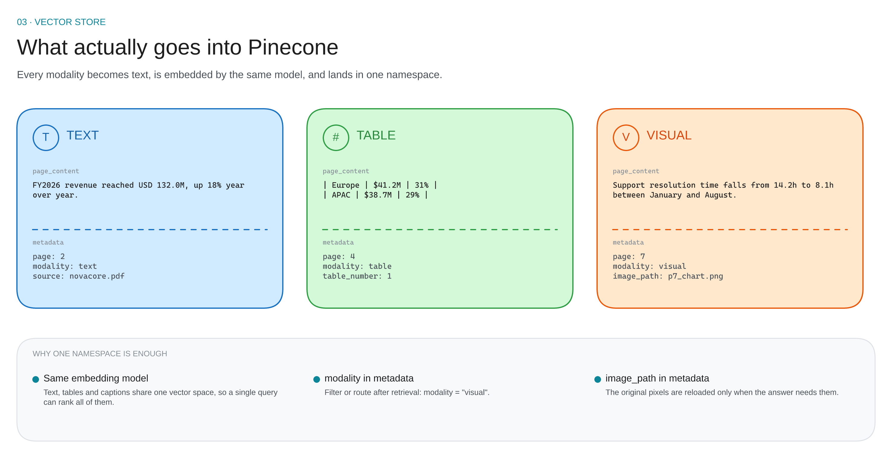

# 03 · Vector store

One index. One namespace. One embedding model. **The modality is metadata, not a separate collection.**

---

## Anatomy of a stored record

Each record has two parts:

| Part | Size | Contains |
|---|---|---|
| **vector** | 384 numbers | the meaning of the text, as coordinates |
| **payload** | a small dict | the original text + the metadata |

What differs per modality is **only the text that was embedded**:

| Modality | What is embedded | Metadata carried |
|---|---|---|
| **Text** | the page's prose | page, modality, source |
| **Table** | the table as markdown | page, modality, table number |
| **Visual** | the VLM summary of the figure | page, modality, image path |

The vector is never the image. The vector is always text.

---

## Why one namespace beats one-per-modality

| | One namespace (chosen) | Namespace per modality |
|---|---|---|
| Cross-modal query | one search ranks text, tables and charts together | you must search N times and merge |
| Routing | read the modality field from the hit | inferred from which namespace answered |
| Ranking | comparable scores, same model, same space | scores are not comparable across searches |
| Filtering | filter on the modality field | native |
| Ops | one index, one backup, one metric | N indexes to keep in sync |

One namespace is the right default. Split only when the modalities genuinely need **different embedding models**.

---

## Filters, not separate searches

Filtering is a metadata condition attached to the search, not a second index.

| Goal | Filter |
|---|---|
| charts only | modality = visual |
| one document | source = novacore.pdf |
| debug one page | page = 7 |
| tables and text, no images | modality ≠ visual |

Filters are cheap and exact. Use them when the question already tells you the answer type ("show me the chart of…").

---

## Embedding model choice

| Model | Dimensions | Cost | Notes |
|---|---|---|---|
| all-MiniLM-L6-v2 | 384 | free, local | default; fast; English |
| bge-small-en-v1.5 | 384 | free, local | slightly better recall |
| text-embedding-3-small | 1536 | paid API | stronger, multilingual |
| text-embedding-3-large | 3072 | paid API | best, double the storage |

Rules that matter more than the model:

1. **The same model must embed the query and the documents.** Mixing models = random results.
2. **Changing the model means re-ingesting everything.** There is no migration path.
3. **Use cosine similarity** so vector length does not dominate the score.

---

## Do not embed the raw image

The tempting shortcut is an image encoder with a shared text/image space.

| Approach | Retrieval quality | Complexity | Verdict |
|---|---|---|---|
| **Text summary** (this build) | good on charts, tables, diagrams | low — one text model | default |
| CLIP-style dual encoder | weak on charts and text-heavy images | medium — two encoders | photos only |
| ColPali / late interaction | best on document pages | high — special index | later |

A chart is not a photo. An image encoder matches "a line chart", not "revenue peaked in Q4". A factual VLM summary matches the actual question.

---

## Failure modes

| Symptom | Cause | Fix |
|---|---|---|
| Every result is a table | tables are long and keyword-dense | cap table length; summarise the table too |
| Charts never retrieved | summary is too generic | ask the VLM for numbers, axis labels, trend |
| Duplicate hits | same text on consecutive pages | dedupe on a hash of the text |
| High score, irrelevant hit | embedding model mismatch | verify one model for query and docs |
| Broken image path | relative path, different working directory | store repo-relative paths and resolve them at load |

---

## Numbers to remember

| Setting | Value |
|---|---|
| Dimensions | 384 (MiniLM) |
| Distance | cosine |
| Metadata per record | keep under 4 KB |
| Namespaces | 1 |
| Batch upsert | 100 vectors |

Next: [retrieval →](04-retrieval.md)
