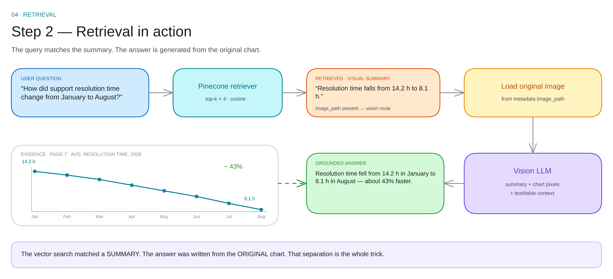

# 04 · Retrieval

The query never touches an image. It matches a **summary**, then the original is loaded. That separation is the whole trick.

---

## The flow

| Step | What happens | What can go wrong |
|---|---|---|
| 1 · embed the question | same model that embedded the documents | model mismatch → nonsense ranking |
| 2 · top-k search | cosine similarity, k = 4 | k too small → the chart sits at rank 5 |
| 3 · read metadata | modality, page, image path | missing image path → no vision route |
| 4 · load originals | read the image files for visual hits | path moved → the answer silently degrades |
| 5 · hand off | text context to the LLM, or text + images to the VLM | too much context → diluted attention |

---

## What a good result looks like

| Rank | Score | Page | Modality | Content |
|---|---|---|---|---|
| 1 | 0.82 | 7 | visual | "resolution time falls from 14.2 h to 8.1 h…" |
| 2 | 0.76 | 2 | text | "FY2026 revenue reached USD 132.0M, up 18%…" |
| 3 | 0.71 | 4 | table | "Europe \| $41.2M \| 31%" |
| 4 | 0.68 | 9 | text | "support staffing increased by 12 agents…" |

If the visual hit is missing from the top 4, no amount of prompting will recover the chart.

---

## Why "search the summary, answer with the original"

| | Search on the summary | Search on the raw image |
|---|---|---|
| Query type | any text question | needs a multimodal encoder |
| Ranking | one text space for all modalities | image space, weak on charts |
| Answer quality | original pixels in front of the VLM | same |
| Debuggability | you can read the summary that matched | opaque |

The summary is a **lossy index**. It is good at *finding* and bad at *answering*, so it is used only for finding.

> If the summary says "14.2 h → 8.1 h" but the chart also shows a dip in May, the VLM can still report the dip — because it receives the chart, not only the summary.

---

## Choosing k

| k | Use when |
|---|---|
| 2–3 | cheap, single-fact questions |
| **4** | default |
| 8–10 | "compare across pages" questions, then rerank |
| 20+ | only with a reranker; otherwise context is noise |

More context is not free: every extra chunk dilutes attention and costs tokens. **k = 4 plus a reranker** beats **k = 20** almost always.

---

## Reranking (optional, high value)

The pattern: retrieve 20 candidates by vector similarity, reorder them with a cross-encoder, keep the top 4.

| Reranker | Cost | Gain |
|---|---|---|
| bge-reranker-base | local, ~30 ms | large on tables and charts |
| Cohere Rerank | API | large, multilingual |
| none | — | fine for a first build |

A reranker sees the question and the chunk **together**, which vector similarity never does.

---

## Debug checklist

When the answer is wrong, check in this order:

1. **Is the right chunk retrieved at all?** Look at the top 20.
2. **Is the summary good?** Read the visual hit's text. If it says "a chart", the summary is the bug — fix the ingestion prompt.
3. **Does the image path resolve?** Check the file exists.
4. **Are the scores sane?** Everything near 0.2 means a model mismatch or an empty index.
5. **Is the filter too tight?** A source filter with a typo returns nothing, silently.

---

## Numbers to remember

| Setting | Default |
|---|---|
| k | 4 |
| Metric | cosine |
| Rerank pool | 20 |
| Context budget | 4 chunks ≈ 2–4k tokens |
| Trust threshold | calibrate per model — do not guess |

Next: [generation →](05-generation.md)
