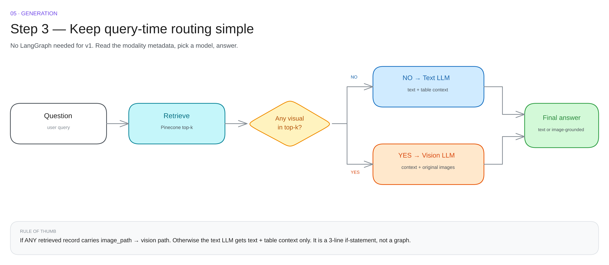

# 05 · Generation & routing

No LangGraph. No agent. **A three-line if-statement.**

---

## The rule

| Condition | Route | What is sent |
|---|---|---|
| any hit is visual and its image path resolves | **vision LLM** | text context + original images |
| everything else | **text LLM** | text + table context |

Why it works: the presence of an image path is a perfect proxy for "this question may need pixels". You do not need a classifier.

---

## The two prompts

**Text path** — the model may only use the retrieved context, must say "not in the document" when the answer is absent, and must cite the page for every number.

**Vision path** — same rules, plus:

> Read values directly from the images. Do not estimate or interpolate. If a value is not visible, say so.

| Instruction | Prevents |
|---|---|
| read values directly | rounding 14.2 down to 14 |
| do not estimate | inventing a point between two plotted values |
| cite page and image | unverifiable answers |
| "not in the document" | hallucination on empty retrieval |

The difference between the paths is **what you send**, not which vendor you call. A vision-capable model can serve both.

---

## Routing table

| top-k contains | Model | Input | Example question |
|---|---|---|---|
| text only | text LLM | text | "What does the policy say about refunds?" |
| text + table | text LLM | text + markdown | "Which region grew fastest?" |
| any visual | vision LLM | text + image files | "How did resolution time change?" |
| visual hit, broken path | text LLM + warning | summary only | — |

---

## Citations

Every answer should be reconstructable. Return the answer **plus its sources**, not a bare string.

| Field | Example |
|---|---|
| answer | "Resolution time fell from 14.2 h (Jan) to 8.1 h (Aug), about 43% faster." |
| sources | page 7, visual, chart path · page 2, text |
| route | vision |

The UI can then show the actual chart next to the answer. That is what makes the system feel grounded rather than confident.

---

## Failure modes

| Symptom | Cause | Fix |
|---|---|---|
| answer ignores the chart | route took the text path | verify modality and image path on the hits |
| numbers slightly wrong | the VLM estimated | tighten the instruction: read, do not estimate |
| cites page 0 | metadata never set at ingestion | fix the metadata contract |
| long answer, half irrelevant | k too high | k = 4, rerank |
| "not in the document" but it is | retrieval missed | debug retrieval, not the prompt |

> 90% of "the LLM is bad" is actually "retrieval sent the wrong chunk". Check the hits before touching the prompt.

---

## Cost per question

| Path | Calls | Relative cost |
|---|---|---|
| text | 1 embedding + 1 chat | 1× |
| vision | 1 embedding + 1 VLM call with 1–2 images | 5–15× |

Cache the question embedding, and cache vision answers per question + image hash.

Next: [end to end →](06-end-to-end.md)
