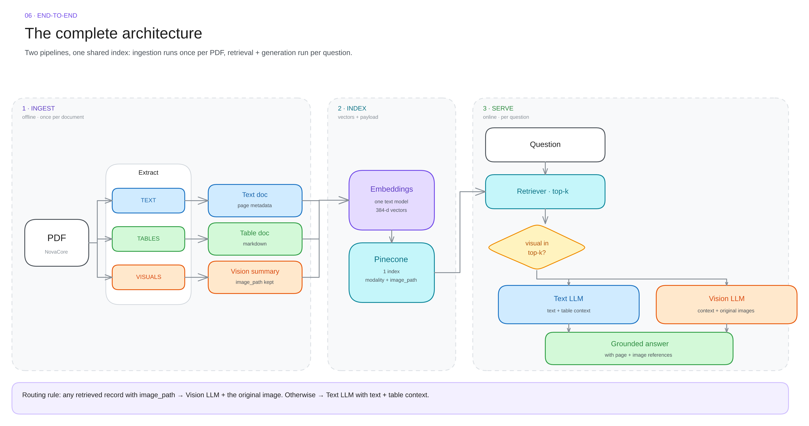

# 06 · End to end

Eleven numbered steps. **1–5 run once per PDF. 6–11 run on every question.** They meet in one index.

---

## The eleven steps

| # | Step | Runs | What it does | Output |
|---|---|---|---|---|
| 1 | **Source** | once | take the PDF | 20 pages of mixed content |
| 2 | **Extract** | once | pull text, tables, visuals | raw pieces, page by page |
| 3 | **Normalise** | once | make three document types | text / table / vision-summary docs |
| 4 | **Embed** | once | one text model, 384-d | one vector per document |
| 5 | **Store** | once | vector + metadata in Pinecone | one namespace, searchable |
| — | **the index** | shared | vector + payload per record | pipeline 1 writes, 2 reads |
| 6 | **Question** | per query | a user asks | one question |
| 7 | **Embed + search** | per query | same model, cosine, k = 4 | ranked candidates |
| 8 | **Top-k chunks** | per query | text, table and visual hits | 4 records with scores |
| 9 | **Route** | per query | any visual hit? | text path or vision path |
| 10 | **Generate** | per query | text LLM, or vision LLM + image | a draft answer |
| 11 | **Answer** | per query | attach citations | answer + page + image |

Steps 1–5 are **ingestion**. Steps 6–11 are **serving**. Nothing is shared between them except the index.

---

## Reading the diagram

| Element | Meaning |
|---|---|
| Numbered circle | the step, in execution order |
| Coloured box | the modality: blue text, green table, orange visual |
| White box | a step that is modality-agnostic |
| Arrow label | the data that moves (pages, documents, vectors, top-k) |
| Bottom note in a card | the one thing that goes wrong there |
| Dashed band | a pipeline: offline on top, online at the bottom |

The **shared index** band in the middle is the only place the two pipelines touch. Everything above it writes; everything below it reads.

---

## Why the index is in the middle

A record has two jobs:

| Part | Read by | Used for |
|---|---|---|
| **vector** (384 floats) | step 7 | finding the record |
| **page_content** | step 10 | giving the model text |
| **metadata** | steps 8–11 | routing, citing, reloading the image |

Retrieval compares vectors. Generation reads the payload. One record, two consumers — that is why the shape must be identical for every modality.

---

## Build order

Do it in this order. Each step is testable on its own, so failures stay local.

| Order | Build | Prove it works by |
|---|---|---|
| 1 | PDF → text documents | printing 3 documents and seeing real prose |
| 2 | text-only RAG end to end | asking a question that the text answers |
| 3 | tables → markdown documents | asking "which region is highest?" |
| 4 | images → VLM summaries | asking a question only a figure answers |
| 5 | image path in metadata | retrieving the figure and opening the file |
| 6 | vision route | the answer quotes a number that exists only in the chart |

Steps 1–2 first. If plain text RAG does not work, multimodal will not fix it — it will hide it.

---

## What to check at each step

| Step | Check | Fails how |
|---|---|---|
| 1–2 | page text is not empty | scanned PDF, silent |
| 3 | every doc has a modality | routing dies later |
| 4 | query and docs use one model | ranking becomes random |
| 5 | record count matches expected | half the document missing |
| 7–8 | right chunk in top 4 | the answer cannot exist |
| 9 | vision route actually fires | charts never reach the model |
| 10–11 | every citation resolves | unverifiable output |

---

## Evaluation that actually helps

| Metric | Question it answers | How |
|---|---|---|
| **Hit rate @ k** | is the right chunk even retrieved? | label ~20 questions with their page |
| **Route accuracy** | did visual hits reach the VLM? | count how often the vision path fired |
| **Faithfulness** | is every claim in the sources? | read the answer against the page |
| **Citation validity** | do the page + path resolve? | check mechanically |

Hit rate first. If the chunk is not retrieved, faithfulness is irrelevant.

---

## Scaling knobs

| Knob | Effect | Watch out |
|---|---|---|
| chunk size | bigger = more context, less precision | page-level is already large |
| k | more recall, more noise | pair with a reranker |
| embedding model | better recall | full re-ingest required |
| summary length | better visual recall | longer prompts, more cost |
| reranker | precision at the top | added latency |
| namespace split | isolation | cross-modal queries get harder |

Change one at a time, and re-run the same 20 questions.

---

## What "done" looks like

- [ ] one question spans text, table and chart in a single answer
- [ ] every answer cites page numbers that exist
- [ ] visual answers show the original image
- [ ] re-ingesting a document does not duplicate vectors
- [ ] a missing image path degrades gracefully instead of crashing
- [ ] the whole pipeline runs from one command

Next: [cheat sheet →](07-cheatsheet.md)
