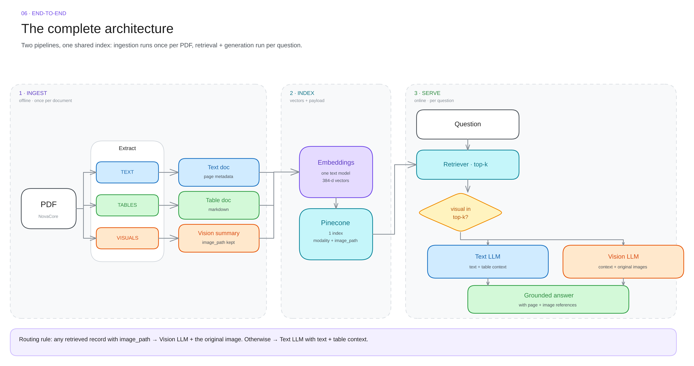

# Multimodal RAG — Field Notes

Visual, no-fluff notes for the multimodal RAG build. **Read the diagram first**; the text only adds what a diagram cannot say.

> **Mental model**
> Turn every useful modality into something **searchable** (text).
> Keep the original **seeable** (pixels).
> *Search the summary, answer with the evidence.*

---

## Two pipelines, three stages

| | **Ingestion** — offline, once per PDF | **Serving** — online, per question |
|---|---|---|
| Runs | when a document is added | on every user query |
| Does | extract → normalise → embed → store | retrieve → route → generate |
| Cost driver | VLM calls per image, embedding calls | top-k, prompt size, model choice |
| Fails quietly? | yes — bad extraction is invisible later | no — bad retrieval shows up as a bad answer |

Serving is two stages: **retrieval** (find candidates) and **generation** (read them and answer). Ingestion + retrieval + generation = the three stages you see in every diagram here.

---

## The map

---

## Files

| # | Note | Diagram | In one line |
|---|------|---------|-------------|
| 00 | [Overview](00-overview.md) | — | vocabulary + the whole idea in 10 lines |
| 01 | [The problem](01-the-problem.md) | [PNG](diagrams/01-the-problem.png) · [SVG](diagrams/01-the-problem.svg) | a real PDF is 4 modalities, text RAG keeps 1 |
| 02 | [Ingestion](02-ingestion.md) | [PNG](diagrams/02-ingestion-pipeline.png) · [SVG](diagrams/02-ingestion-pipeline.svg) | PDF → text / table / vision-summary docs |
| 03 | [Vector store](03-vector-store.md) | [PNG](diagrams/03-vector-store.png) · [SVG](diagrams/03-vector-store.svg) | one embedding model, one namespace, modality in metadata |
| 04 | [Retrieval](04-retrieval.md) | [PNG](diagrams/04-retrieval.png) · [SVG](diagrams/04-retrieval.svg) | match the summary, load the original |
| 05 | [Generation](05-generation.md) | [PNG](diagrams/05-generation-routing.png) · [SVG](diagrams/05-generation-routing.svg) | visual in top-k? → vision LLM, else text LLM |
| 06 | [End to end](06-end-to-end.md) | [PNG](diagrams/06-end-to-end.png) · [SVG](diagrams/06-end-to-end.svg) | the full build order + checklist |
| 07 | [Cheat sheet](07-cheatsheet.md) | — | one page, everything, for revision |

---

## Opening the diagrams

| File | Use |
|---|---|
| `diagrams/*.png` | quick look, GitHub preview, slides |
| `diagrams/*.svg` | zoom without blur, dark background |
| `diagrams/*.excalidraw` | editable — drag into [excalidraw.com](https://excalidraw.com) |
| `index.html` | the interactive walkthrough (open locally) |

The `.excalidraw` files keep real arrow bindings: move a box, the arrows follow.

---

## Colour code (same in every diagram)

| Colour | Means |
|---|---|
| 🟦 Blue | **text** modality |
| 🟩 Green | **table** modality |
| 🟧 Orange | **visual** modality (image / chart / diagram) |
| 🟪 Purple | models — embeddings, LLMs |
| 🟦 Cyan | storage & retrieval (Pinecone) |
| 🟥 Red | what breaks |

Same colour = same role, in every diagram. That is deliberate — you should be able to skim a diagram and know where you are.
